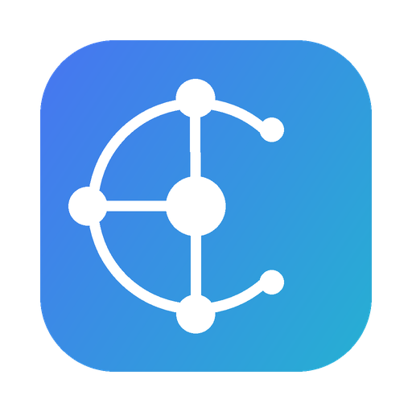
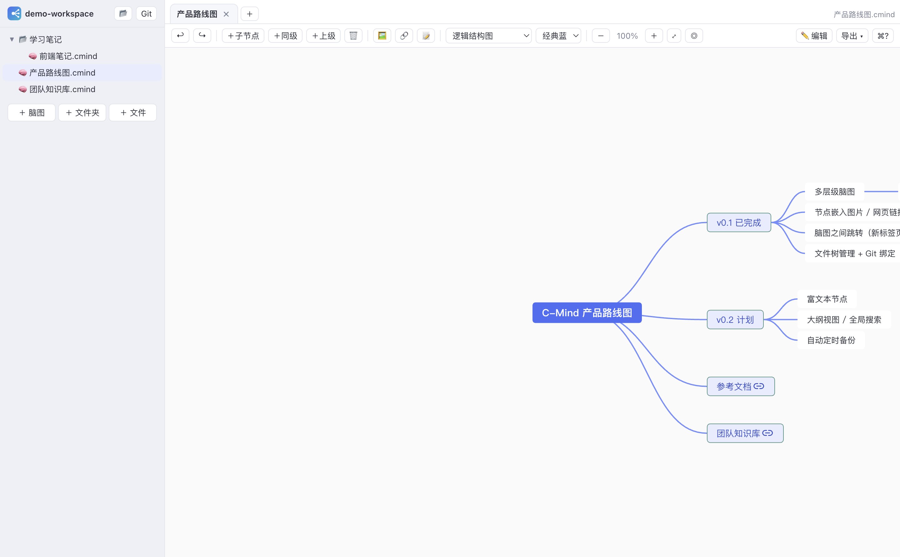

# C-Mind 心图 🧠

[](LICENSE)
[]()
[](https://www.electronjs.org/)
[](https://github.com/chrisblob/c-mind/actions/workflows/ci.yml)

> 本地优先的 macOS 桌面脑图工具 —— 把思维导图当「文件」来管理，把知识用「链接」串起来。

📥 [下载最新版](https://github.com/chrisblob/c-mind/releases) · 🐛 [反馈问题](https://github.com/chrisblob/c-mind/issues) · 📖 [更新日志](CHANGELOG.md)






## 一、名字与语义

**C-Mind**（中文名 **心图**）

- **C = Connect（连接）**：节点可嵌入网页链接、图片，更可以把一张脑图链接到另一张脑图，思维在图谱之间自由跳转；
- **C = Chain（思维链）**：脑图以 `.cmind` 纯文本文件存储在工作区文件夹中，文件夹即脑图库，可整体绑定 Git / GitHub，形成可版本化的知识链；
- **C = Create（创造）**：Xmind 一致的快捷键与极简界面，让记录想法快到不打断思路；
- 中文「心图」：Mind Map 的 Mind 既指头脑也指内心，用心绘制的图谱，即为心图。

## 二、图标设计思路

图标为 **macOS 规范圆角方形 + 靛蓝→青色对角渐变**（深→浅，象征思维从混沌到清晰），前景是白色图形：

- **中心节点**：你正在思考的核心命题；
- **C 形弧线**：右侧留出开口 —— 它既是字母 **C**，也是导图分支的生长轨迹，开口代表思维永远向新方向开放；
- **三个分支节点 + 连接线**：放射式的思维导图结构，也是「连接」语义的具象化。

生成方式可复现：`pnpm icon`（等价于 `python3 scripts/gen-icon.py && bash scripts/make-icns.sh`，需要 python3 + Pillow）。

## 三、功能

| 功能 | 说明 |
| --- | --- |
| 多层级脑图 | 基于 simple-mind-map，7 种布局（逻辑图 / 思维导图 / 组织结构 / 鱼骨 / 时间轴…） |
| Xmind 快捷键 | `Tab` 子节点、`Enter` 同级、`⇧Tab` 上级、`⌘Z` 撤销…（应用内点 `⌘?` 查看全部） |
| 节点嵌网页链接 | 节点工具栏 🔗 → 网页链接，点击后在系统浏览器打开 |
| 节点嵌图片 | 本地图片以 base64 内嵌（随文件走），或填网络图片地址；画布内仅显示缩略图（≤200×100，保证版面美观），点击节点中的图片（或工具栏 🔍 / 右键「查看图片大图」）可在弹窗中放大/缩小查看（支持 ＋/－ 按钮、滚轮、拖动平移、适合窗口、100%） |
| 节点内换行 | 编辑节点时按 **Shift+Enter** 在节点内换行（Enter 为保存并新建同级节点） |
| 侧栏排序 | 新建的脑图/文件夹显示在最上面（按创建时间倒序） |
| 导入 | 侧栏工具栏 📥（新建脑图/新建文件夹旁）。位置规则与「新建于」一致：**选中文件夹 → 该文件夹；选中脑图 → 其所在文件夹**；都未选 → 根目录。文件名 = 导入图的根节点名称（重名自动加 -1/-2），导入后自动在新标签打开，不改动已打开的脑图；支持 XMind（.xmind 新/旧版）、FreeMind/Freeplane（.mm）、OPML 大纲（幕布/Workflowy 等）、Markdown 大纲（.md）、JSON/.cmind；XMind 内嵌图片自动转为 base64 随文件保存，节点链接（网页 / cmind:// 脑图链接）一并导入 |
| 空白清理 | 带图片/链接的节点会自动清理多余空白字符（导入的 `\n` 空标题等） |
| 导出 | XMind（.xmind）、FreeMind（.mm）、OPML、Markdown（.md）、JSON、PNG、SVG —— 均可被对应平台导入 |
| 脑图之间跳转 | 🔗 → 脑图链接，选择工作区里任意一张 `.cmind`；点击后**在新标签页打开** |
| 两种管理方式 | **标签页（查看模式）**：多开、跳转、只读查看模式、文件夹视图（列表/平铺）；**文件树（管理模式）**：文件夹 + 文件、默认按名称排序（文件夹在前）、按名称自动排序（文件夹在前）、点击文件夹右侧展示内容、新建 / 重命名 / 移动（可拖拽到文件夹）/ 删除（进废纸篓）；**移动/重命名自动更新所有脑图互链**；**同文件夹内名称唯一**（重名创建/重命名会明确报错） |
| Git / GitHub 绑定 | 工作区一键 `git init` + 绑定远程仓库（HTTPS + PAT），提交 / 推送 / 拉取 / 历史 一面板搞定 |
| 自动保存 | 编辑后自动落盘，`⌘S` 随时手动保存 |
| 主题 | 经典蓝 / 青竹绿 / 暖阳橙 / 暗夜紫 四套预设配色 |

## 四、快捷键（与 Xmind 一致）

| 按键 | 功能 | 按键 | 功能 |
| --- | --- | --- | --- |
| `Tab` | 添加子节点 | `⌘Z` / `⌘Y` | 撤销 / 重做 |
| `Enter` | 添加同级节点 | `⌘C` / `⌘X` / `⌘V` | 复制 / 剪切 / 粘贴节点 |
| `⇧Tab` | 添加上级节点 | `⌘↑` / `⌘↓` | 节点上移 / 下移 |
| `⌫` / `Del` | 删除节点 | `⌘A` | 全选节点 |
| 直接输入文字 | 编辑节点文本 | `/` | 展开 / 收起 |
| 触控板 / 滚轮 | 缩放画布 | `⌘G` | 添加概要 |
| `⌘S` | 保存 | `⌘N` / `⌘W` | 新建脑图 / 关闭标签 |

> 提示：左侧「＋ 脑图 / ＋ 文件夹」在**当前操作文件夹**下创建（点击文件夹切换）；文件名与脑图根节点名称自动同步。

## 五、文件格式

`.cmind` 是纯 JSON（包含布局 / 主题 / 视图 / 节点树），对 diff 与版本控制友好，任何编辑器都能打开：

```json
{
  "format": "c-mind",
  "version": 1,
  "layout": "logicalStructure",
  "theme": { "template": "default", "config": {} },
  "view": null,
  "root": { "data": { "text": "中心主题" }, "children": [] }
}
```

## 六、Git / GitHub 绑定

1. 侧栏点 **Git** → 填仓库地址（`https://github.com/you/repo.git`）、用户名、**Fine-grained PAT**（需 repo 读写权限）；
2. Token 只保存在本机配置（未打包时在 `.userdata/config.json`，打包后在 `~/Library/Application Support/C-Mind/`），推送时拼接进 URL，不写入 `.git/config`；
3. 「绑定 / 更新」会自动 `git init`（如尚未是仓库）并校验凭据；之后即可在面板中 **提交 → 推送 → 拉取**，查看最近 20 条历史。

## 七、自己打包：环境配置与命令

### 7.1 环境要求

| 依赖 | 版本 | 说明 |
| --- | --- | --- |
| macOS | 12+（Apple Silicon） | 当前仅产出 arm64 安装包；Intel 需自行改 `electron-builder.yml` 的 target arch |
| Xcode Command Line Tools | 任意 | 提供 `codesign`（打包时自动补 ad-hoc 签名必需）：`xcode-select --install` |
| Node.js | >= 20（推荐 22 LTS） | |
| pnpm | >= 9 | 包管理器 |
| python3 + Pillow | 可选 | 仅 `pnpm icon` 重新生成图标时需要 |

```bash
# 一次性环境准备（macOS）
xcode-select --install
brew install node@22 pnpm      # 或使用 nvm/fnm 安装 Node 后 corepack enable
node -v && pnpm -v
```

### 7.2 获取源码与安装依赖

```bash
git clone https://github.com/chrisblob/c-mind.git
cd c-mind
pnpm install
```

> **关键**：仓库内的 `.npmrc` 设置了 `node-linker=hoisted`，**不要删除**。
> pnpm 默认的符号链接布局会导致 electron-builder 打出的包里没有 `node_modules`
> （运行时报 `Cannot find module 'adm-zip'` / `simple-git`）。CI 同样依赖该配置。

### 7.3 常用命令

| 命令 | 实际执行 | 用途 |
| --- | --- | --- |
| `pnpm dev` | Vite 热更新 + Electron | 日常开发 |
| `pnpm build` | `vite build` | 只构建渲染层到 `dist/` |
| `pnpm start` | `electron .` | 运行已构建产物 |
| `pnpm pack` | `vite build` + `electron-builder --dir` | 只出 `.app`（`release/mac-arm64/`），不解 dmg，最快验证 |
| `pnpm dist` | `vite build` + `electron-builder --mac` + 签名校验 | **正式打包**：`.app` + `.dmg` |
| `pnpm icon` | 重新生成图标 | 需要 python3 + Pillow |

打包产物（`pnpm dist` 后）：

```
release/mac-arm64/C-Mind.app        # 可直接运行的应用
release/C-Mind-<版本>-arm64.dmg     # 分发用安装盘
```

### 7.4 打包后自检（建议每次发布前执行）

```bash
# 1) 签名有效（打包钩子已自动签名，这里复核）
codesign --verify --deep --strict release/mac-arm64/C-Mind.app

# 2) dmg 完整性
hdiutil verify release/C-Mind-*.dmg

# 3) 启动冒烟 + 端到端自检（默认不触碰任何 Git 远程）
CMIND_UITEST=1 pnpm start                 # 日志中应出现 [uitest] RESULT
```

### 7.5 签名与分发说明

- 默认构建使用 **ad-hoc 签名**（`scripts/after-pack.js` 钩子自动执行，无证书要求）。
  已签名的包安装后首次打开仍会提示「无法验证开发者」：**右键 → 打开**，或执行
  `xattr -cr /Applications/C-Mind.app`。
- 未签名/缺签名的包在别人电脑上会直接报「**已损坏**」——所以不要去掉 afterPack 钩子。
- 如需彻底无提示（公证），需要 Apple Developer Program（$99/年）：
  ```bash
  export CSC_LINK=<Developer ID Application 证书 .p12 路径或 Base64>
  export CSC_KEY_PASSWORD=<证书密码>
  export APPLE_ID=<Apple ID>            # 公证所需
  export APPLE_APP_SPECIFIC_PASSWORD=<App 专用密码>
  export APPLE_TEAM_ID=<Team ID>
  pnpm dist
  ```
  并在 `electron-builder.yml` 的 `mac` 段把 `identity: null` 改为 `identity: "Developer ID Application"`。

### 7.6 用 CI 打包（免本地环境）

推 `v*` tag 即自动构建并上传到 GitHub Releases（`.github/workflows/release.yml`）：

```bash
git tag -f -a v1.0.0 -m "release" && git push -f origin v1.0.0
```

`examples/demo-workspace/` 内置了一套示例脑图库（产品路线图 / 团队知识库 / 学习笔记，
含脑图互链与网页链示例），开发模式（`pnpm dev`）默认指向它，可直接体验脑图跳转。

## 八、技术栈

- **Electron** — 桌面壳，主进程通过受控 IPC（contextIsolation）暴露文件与 Git 能力
- **Vue 3 + Vite** — 渲染层
- [simple-mind-map](https://github.com/wanglin2/mind-map)（思绪思维导图内核）— 脑图渲染 / 编辑 / 布局 / 导出
- **simple-git** — 工作区 Git 操作
- electron-builder — 打包分发

## 九、路线图

- [ ] 富文本节点（simple-mind-map RichText 插件）
- [ ] 大纲视图、全局搜索（Search 插件）、关联线（AssociativeLine）
- [ ] 节点 Drill 下钻演示模式
- [ ] 多工作区切换、iCloud 目录支持
- [ ] 自动定时 commit（知识库时间机器）

## 十、下载安装

| 平台 | 文件 | 安装方式 |
| --- | --- | --- |
| macOS (Apple Silicon) | `C-Mind-<version>-arm64.dmg` | 打开 dmg，拖入「应用程序」 |
| Windows 10/11 x64 | `C-Mind-<version>-win-x64-setup.exe` | 双击安装（可选安装目录） |
| Windows 免安装 | `C-Mind-<version>-win-x64.zip` | 解压后运行 `C-Mind.exe` |

- **Windows 注意**：
  - 应用未做代码签名，SmartScreen 可能提示「已保护你的电脑」→ 点 **更多信息 → 仍要运行**
  - Git 绑定 / 提交推送功能需要本机已安装 [Git for Windows](https://git-scm.com/download/win)（脑图编辑不依赖）
- **macOS 注意**：未公证，首次打开右键 → 打开，或 `xattr -cr /Applications/C-Mind.app`
- **从源码构建**：见「七、本地开发与打包」
- 未做代码签名/公证：首次打开若提示无法验证开发者，请右键 → 打开，或到「系统设置 → 隐私与安全性」点「仍要打开」

## 十一、参与贡献

欢迎 Issue 与 PR！开发环境、目录结构、提交规范、自测方式见 [CONTRIBUTING.md](CONTRIBUTING.md)。
安全问题请按 [SECURITY.md](SECURITY.md) 私下报告。

## 十二、许可证

[MIT](LICENSE) © 2026 Chris
