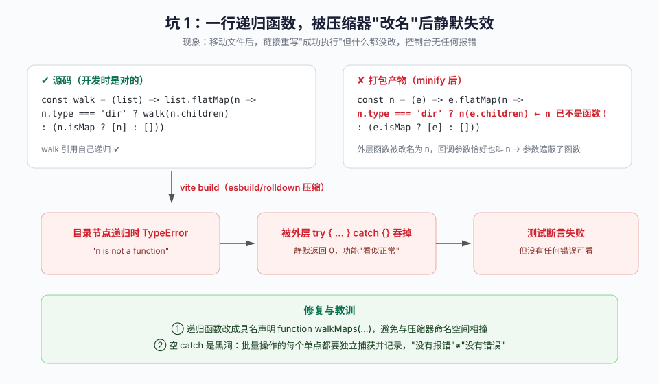
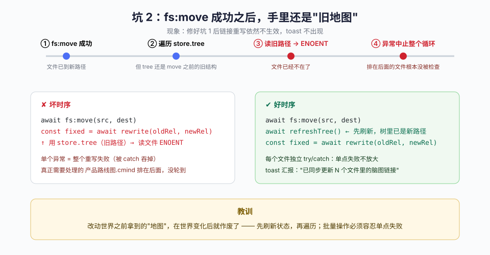
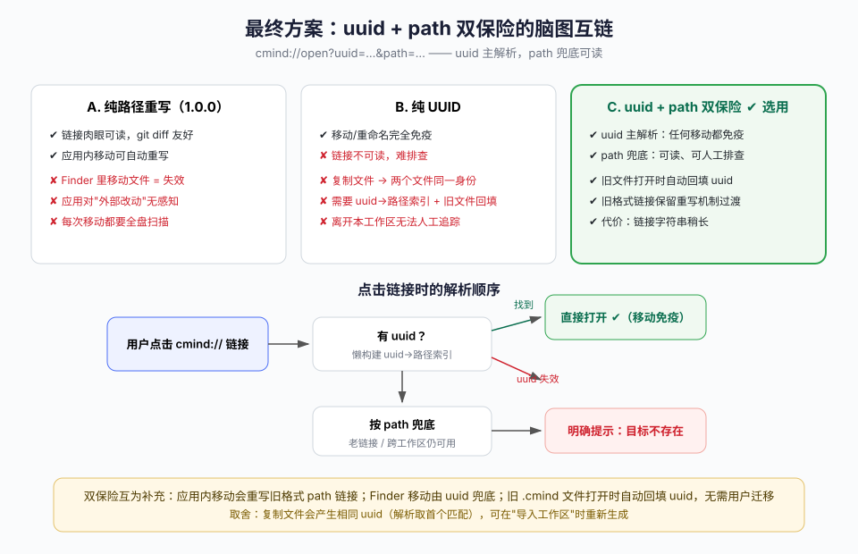
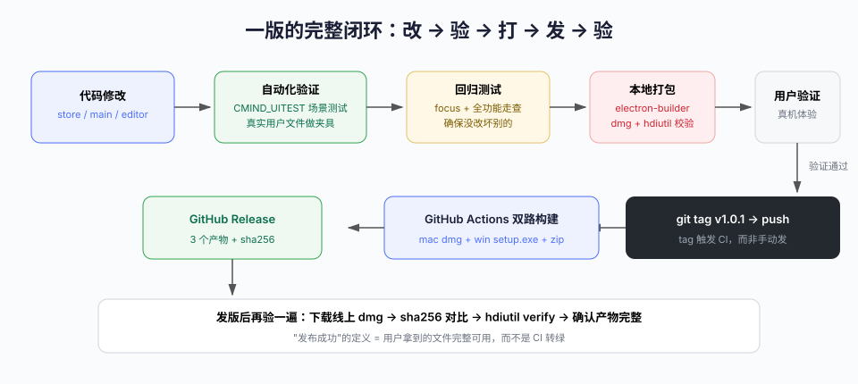

# AI 结对开发实战复盘：C-Mind 1.0.1 里埋过的五个坑，和它们教会我的事

> 这是一篇真实的开发复盘。主角是一个 Electron 桌面应用 [C-Mind（心图）](https://github.com/chrisblob/c-mind)，一个本地优先的脑图工具（Electron 45 + Vue 3 + simple-mind-map）。从 v1.0.0 到 v1.0.1 的迭代由 AI 结对完成：人类提需求和验收，AI 写代码、写测试、打包、发版。
>
> 这篇文章不讲"AI 多高效"，只讲**这一版里埋过的五个坑**。它们有个共同点：每一个在发生时都被某种"静默"掩盖了——没有报错、提示成功、构建"看起来"没问题。排查它们的过程，比写十个新功能更有价值。

**目录**

1. [背景：这一版要做什么](#1-背景)
2. [坑 1：一行递归函数被压缩器"改名"后静默失效](#2-坑-1)
3. [坑 2：fs:move 成功之后，手里还是"旧地图"](#3-坑-2)
4. [坑 3：被 tail -1 掩盖的构建失败（跑了 1 小时旧代码）](#4-坑-3)
5. [坑 4："推送成功"，但其实什么都没推](#5-坑-4)
6. [坑 5：两个模块各自"合理"，接口处对不上](#6-坑-5)
7. [嵌入的架构决策：文件互链的三种设计](#7-架构决策)
8. [一版的完整闭环](#8-发版闭环)
9. [总结：七条验证纪律](#9-总结)

---

<a id="1-背景"></a>
## 1. 背景：这一版要做什么

v1.0.0 发布后，用户反馈集中在一个痛点上：

> "文件移动后，文件之间的链接失效了吗？我不希望失效。"

C-Mind 支持脑图之间互相链接（`cmind://open?path=<相对路径>`），链接存的是**文件的相对路径**。文件一移动、一重命名，链接就指向了不存在的位置。

围绕这个核心诉求，v1.0.1 实际完成了 6 件事：

| # | 需求 | 落点 |
|---|------|------|
| 1 | 移动/重命名后脑图互链不失效 | 先做路径重写，后升级为 uuid+path 双保险（见第 7 节） |
| 2 | 同文件夹内名称唯一 | 重名创建/导入/重命名直接报错，不再自动加 `-1/-2` |
| 3 | 文件树按名称排序 | 移除拖拽排序功能，`zh-Hans-CN` 拼音序 |
| 4 | 根节点改名 → 文件名同步 | 原有能力，本次补上"同步时也要重写互链" |
| 5 | Git 推送防误报 | 无待推送提交时明确报错 |
| 6 | Markdown 导入 | 修 kind 归一化 + 第一个一级标题作根节点 |

下面按"坑"的组织方式复盘。

---

<a id="2-坑-1"></a>
## 2. 坑 1：一行递归函数被压缩器"改名"后静默失效



### 现象

实现了"移动文件后自动重写全工作区链接"的功能。自动化测试显示：文件确实移过去了，但其他文件里的链接**纹丝不动**，toast 也没有出现。整个过程中，控制台**没有任何报错**。

### 排查

先怀疑正则——直接用 Node 对目标文件跑同样的正则，匹配、解码全部正常。再怀疑跳过条件——打开中的"脏"标签会跳过重写，测试证明也不是。

最后把打包产物翻出来，在这段代码旁边看到了这一行：

```js
// dist 里的产物（minify 后）
n.type === 'dir' ? n(e.children) : ...
//              ↑ 这里的 n 已经不是那个递归函数了
```

### 根因

源码里写了一个**箭头函数表达式**的递归：

```js
const walk = (list) => (list || []).flatMap(n =>
  n.type === 'dir' ? walk(n.children) : (n.isMap ? [n] : [])
)
```

打包器把顶层函数 `walk` 重命名成了 `n`，而 `flatMap` 的**回调参数恰好也叫 `n`**——参数把函数遮蔽了。运行到目录节点时，`n(e.children)` 实际是在"调用一个树节点对象"，抛出 `TypeError: n is not a function`。

而这个 TypeError 恰好发生在一个 `try { … } catch { /* 吞掉 */ }` 里——**异常被整个吞掉，函数返回 0，一切看起来风平浪静**。

### 修复与教训

```js
// 修复：具名函数声明，递归引用自己的名字
function walkMaps(list) {
  return (list || []).flatMap(item =>
    item.type === 'dir' ? walkMaps(item.children) : (item.isMap ? [item] : [])
  )
}
```

- **空 catch 是黑洞**。`catch {}` 写的时候想法是"链接重写失败不该阻断移动"，但它同时吞掉了"重写逻辑本身写错了"这个信号。
- **压缩器会重命名一切**。手写代码里的名字遮蔽，压缩后可能变成完全不同的遮蔽关系。
- **"没有报错"≠"没有错误"**。当功能静默失效时，第一个怀疑对象应该是"错误被谁吃掉了"。

---

<a id="3-坑-2"></a>
## 3. 坑 2：fs:move 成功之后，手里还是"旧地图"



### 现象

修好坑 1 后重新测试，链接重写**依然**不生效。这次连"吞异常"的嫌疑都排除了（debug 面板显示函数确实在跑）。

### 排查

给重写函数临时加了诊断输出：遍历到哪个文件、有没有改写、异常是什么。结果一目了然：

```
checked: [
  { name: "测试脑图.cmind", changed: false },
  { name: "前端笔记.cmind", skip: "no-link" },
  { error: "ENOENT: no such file or directory, open '.../团队知识库.cmind'" }
]
```

遍历到 `团队知识库.cmind` 时读文件失败——**这个文件刚刚被移走，读的是旧路径**。异常再次中止了整个循环，而真正需要重写的 `产品路线图.cmind` 排在它后面，根本没轮到。

### 根因

```js
// 坏时序
await api('fs:move', src, destDir)          // 文件系统已变
const fixed = await rewriteLinksAfterMove(…) // 但 store.tree 还是 move 之前的旧结构
```

`store.tree` 是应用启动/刷新时构建的内存树。`fs:move` 改变的是磁盘，内存树没变——拿着旧地图走新路，必然踩坑。

### 修复

```js
// 好时序：先刷新状态，再遍历；单点失败不放大
await api('fs:move', src, destDir)
await refreshTree()                                   // 树里已是新路径
const fixed = await rewriteLinksAfterMove(oldRel, newRel)
if (fixed) toast(`已同步更新 ${fixed} 个文件里的脑图链接`, 'ok')
```

同时把"整个函数一个大 try/catch"改成"**每个文件独立 try/catch**"——一个文件读不出来，不应该让其余 20 个文件失去被修复的机会。

### 教训

- **改动世界之前拿到的地图，在世界变化后就作废了**。任何"先操作、后遍历"的代码，都要问一句：遍历所依赖的状态，是操作前的还是操作后的？
- **批量操作的失败半径**：单点失败不应该放大为整体失败。逐项捕获、汇总结果、如实上报。

---

<a id="4-坑-3"></a>
## 4. 坑 3：被 `tail -1` 掩盖的构建失败（跑了 1 小时旧代码）

### 现象

这是最离谱的一个。连续几轮自动化测试的结果诡异且自相矛盾：新加的测试步骤没有出现、某个目录"应该存在却不存在"、错误信息指向的代码行和源码对不上。整整一个多小时，一直在"幽灵现象"里打转。

### 根因

最终发现：**Vite 构建早就失败了，但没有任何一轮测试用上过新代码**。

```bash
# 当时的构建命令
./node_modules/.bin/vite build 2>&1 | tail -1
# 输出："}"          ← 错误对象 JSON 的最后一个字符，被当成了"正常输出"
```

`tail -1` 恰好截到了错误堆栈的收尾括号 `}`，看起来"构建跑过了"。实际上 rolldown 报了构建错误，`dist/` 里一直是**上一个成功的旧产物**。之后每一轮"测试"验证的都是旧代码，每一个诡异现象都因此无法解释。

而构建失败的源头，又是坑 3 本身的成因：AI 用**字符串标记替换**（`s.index` 定位 + 切片拼接）往测试文件里插代码，`end` 标记匹配到了外层的 `} catch`，把 `if` 块的闭合括号吃掉了——语法错误，构建失败。

### 修复与教训

```bash
# 修复：看成功标志，而不是"最后一行长什么样"
./node_modules/.bin/vite build 2>&1 | grep -E "✓ built|error"
```

- **自动化脚本必须检查退出码/成功标志**。"命令执行完了"和"命令成功了"是两回事。
- **对代码做字符串手术是高危操作**。AI 批量修改代码后，必须立刻做语法校验（`node --check`、构建），构建失败要看得见完整报错。
- **诡异现象先怀疑工具链**：当测试结果和源码逻辑对不上时，第一时间确认"跑的到底是不是这份代码"。

---

<a id="5-坑-4"></a>
## 5. 坑 4："推送成功"，但其实什么都没推

### 现象

用户报告："提示文件推送到 git 成功了，但实际上没推送上去。"

### 根因

应用内 Git 面板的推送逻辑（简化后）：

```js
const s = await git.status()
const branch = s.current || 'main'
await git.push([remoteUrl, branch])
return { ok: true, branch }        // ← push 是 no-op 也会走到这里
```

`git push` 在**本地没有新提交**时是一次 no-op——不报错、不改变任何东西。但我们的代码把"没有抛异常"当成了"推送成功"，弹了 toast。用户以为推上去了，实际上远程纹丝未动。

### 修复

```js
if (s.ahead === 0 && s.tracking) {
  throw new Error('本地没有待推送的提交（远程已同步）。请先「提交」再「推送」')
}
await git.push([remoteUrl, branch])
return { ok: true, branch, ahead: s.ahead || 0 }
// toast: `已推送 ${r.ahead} 个提交到 ${r.branch}`
```

成功提示从"已推送到 main"变成"**已推送 N 个提交到 main**"——N=0 的情况在入口就被拦住了。

### 教训

**"操作成功"的正确定义是"产生了预期效果"，而不是"没有抛异常"。** 这是所有"执行类"功能（推送、导出、同步……）的通用坑。判定依据要来自结果（ahead 数、写入的文件数、上传的资产数），而不是过程没有出错。

---

<a id="6-坑-5"></a>
## 6. 坑 5：两个模块各自"合理"，接口处对不上

### 现象

用户拿一份真实的 Markdown 大纲（《人月神话》大纲）导入，应用直接报错："不支持的格式：md"。但代码里明明**写好了完整的 Markdown 解析器**（标题层级、有序/无序列表、代码块忽略，一应俱全）。

### 根因

两个模块各自都"合理"：

```js
// 主进程（electron/main.cjs）：按扩展名返回文件类型
return { kind: ext, … }        // ext === 'md' → kind = 'md'

// 渲染进程（formats.js）：按解析器名称分发
if (kind === 'markdown') return parseMarkdown(text)
throw new Error('不支持的格式：' + kind)   // ← 'md' 不认识
```

主进程说"这是 md 文件"，解析器说"我只认 markdown"——**没有一个模块是错的，错在接口契约没有对齐**。而且不止 Markdown：`.mm`（FreeMind）同样中招（`'mm'` vs `'freemind'`），意味着这个 bug 从 v1.0.0 就存在。

### 修复

```js
// 主进程出口处统一归一化：扩展名 → 解析器名称
const KIND_MAP = { md: 'markdown', markdown: 'markdown', txt: 'markdown', mm: 'freemind' }
return { path: abs, name, ext, kind: ext === 'cmind' ? 'json' : (KIND_MAP[ext] || ext), text }
```

顺手做了个体验改进：Markdown 的**第一个一级标题作为脑图根节点**（原来写死"导入笔记"），这样导入《人月神话大纲.md》得到的是——根节点"人月神话"、文件名"人月神话.cmind"，符合"文件名 = 根节点名"的产品规则。

### 教训

- **单元全对 ≠ 集成正确**。两个模块的"各自合理性"恰恰是集成 bug 最 comfortable 的温床——因为每一侧的测试都是绿的。
- **用真实用户文件做回归夹具**。这次直接拿用户报障的 `人月神话大纲.md` 跑端到端测试，一次验证了格式识别、解析结构、根节点命名、文件落盘四件事。

---

<a id="7-架构决策"></a>
## 7. 嵌入的架构决策：文件互链的三种设计

坑 1-2 修完后，功能本身可用。但复盘时用户问了一个更好的问题：

> "链接失效是怎么修复的？建议每个文件有一个唯一的 uuid……可以对比一下两种方案的优缺点再确定怎么实现。"

这个提问推动了一次真正的方案对比，最终把"路径重写"升级成了 **uuid + path 双保险**。



### 三种方案的完整对比

| 维度 | A. 纯路径重写 | B. 纯 UUID | C. uuid + path 双保险 ✅ |
|------|--------------|-----------|------------------------|
| 应用内移动/重命名 | ✅ 自动重写 | ✅ 完全免处理 | ✅ 免处理 |
| **Finder 里直接移动** | ❌ 失效（应用无感知） | ✅ 免疫 | ✅ 免疫 |
| 链接可读性 | ✅ 肉眼可读 | ❌ 随机码 | ✅ path 部分可读 |
| 复制文件 | 无影响 | ❌ 两个文件同一身份 | ⚠️ 同左（解析取首个匹配） |
| 实现复杂度 | 中（每次移动全盘重写） | 高（索引 + 回填 + 去重） | 中高（复用 A 的机制兜底） |
| 离开本工作区 | ✅ 人工可追踪 | ❌ | ✅ |

### 最终设计的三个关键点

1. **解析顺序**：点击链接 → 有 uuid 先按 uuid 解析（懒构建 `uuid → 路径` 索引）→ 找不到再按 path 兜底 → 都失败才报"目标不存在"。uuid 解决"移动免疫"，path 保留"可读可排查"。
2. **旧数据零迁移**：旧 `.cmind` 文件**打开时自动回填 uuid**（打开中有未保存改动的跳过，避免覆盖用户编辑）；旧格式纯 path 链接**保留重写机制**继续有效。用户无感升级。
3. **失效边界诚实暴露**：手动复制文件会产生相同 uuid（解析取首个匹配），这是已知取舍，文档写明，后续可在"导入工作区"入口重新生成。

**决策方法论**：用户提议的方案（纯 UUID）直指原方案的真实短板（外部移动无感知），但直接照搬会引入新问题。**把提议当需求（移动后链接不能失效），而不是当设计**——最终设计同时满足了原始诉求、可读性和迁移成本。

---

<a id="8-发版闭环"></a>
## 8. 一版的完整闭环



v1.0.1 的发布流程值得记录，因为每一步都有"防呆"：

1. **版本号先升**（1.0.0 → 1.0.1），避免验证包和线上 Release 混淆；
2. **每个修复独立验证**：真实用户文件（`人月神话大纲.md`）跑端到端，断言导入的根节点、节点数、落盘路径；
3. **回归两件套**：focus 场景 + 全功能走查，确保新修复没改坏旧功能；
4. **本地打包验证**：`hdiutil verify` 校验 dmg 完整性，ad-hoc 签名；
5. **用户真机验收**后才打 tag；
6. **tag 触发 CI**（GitHub Actions mac + win 双路），而不是手动传产物；
7. **发版后再验**：从线上下载 dmg，sha256 与 Release 页公布值比对，`hdiutil verify` 通过——"发布成功"的定义是**用户拿到的文件完整可用**。

---

<a id="9-总结"></a>
## 9. 总结：七条验证纪律

五个坑，五种"静默"：异常被吞、状态过期、输出被截断、成功被误判、契约没对齐。对应的纪律：

1. **每个修复都要自动化验证**——用真实用户文件做夹具，断言可观测的结果（文件内容、toast、链接解码值），而不是"代码跑完了"。
2. **不许空 catch**——批量操作的每个单点独立捕获并记录。"没有报错"≠"没有错误"。
3. **构建看成功标志**——`✓ built` / 退出码，不是"最后一行输出"。自动化改代码后立刻语法校验。
4. **先刷新状态，再遍历**——"先操作后扫描"的代码，问一句：手里的地图是操作前的还是操作后的？
5. **批量操作容忍单点失败**——失败半径要小，结果要汇总上报。
6. **"成功" = 产生了预期效果**——用结果指标（ahead 数、更新文件数）判定，而非"没抛异常"。
7. **接口契约做端到端验证**——两侧单元测试全绿，挡不住 kind 命名没对齐。

最后一条是给 AI 结对协作本身的：**AI 写代码的速度远快于人类，但"验证"不能同速打折**。这一版的每一个坑，都是在"验证被简化"的瞬间埋下的；每一个被逮住，也都是因为验证纪律守住了。工具越快，刹车越重要。

---

*C-Mind（心图）：本地优先的脑图工具，[github.com/chrisblob/c-mind](https://github.com/chrisblob/c-mind)，当前版本 v1.0.1。*
